# YouTube Scraper → Google Sheets

An n8n workflow that extracts YouTube video details into a structured Google Sheet. It uses the **official YouTube Data API v3**, so it's stable and within YouTube's terms of service, with no HTML scraping that breaks when the page changes.

**Case study:** [harshith-nayaka-l-portfolio.vercel.app/work/youtube-scraper-google-sheets](https://harshith-nayaka-l-portfolio.vercel.app/work/youtube-scraper-google-sheets): the problem, the architecture and the engineering decisions behind this workflow.

**Captured per video:**
- Title, channel name, description, publish date and view count
- Like count, comment count, duration, tags, thumbnail, channel ID, video URL
- Source input, first seen, last updated

---

## How it works

You manage what to scrape from an **Inputs** tab in the sheet. Column A accepts any of:

| Input | Example |
|---|---|
| Search words | `n8n automation tutorial` |
| Video URL | `youtube.com/watch?v=…`, `youtu.be/…`, `/shorts/…`, `/live/…` |
| Playlist URL | `youtube.com/playlist?list=…` |
| Channel | `@handle`, `youtube.com/@handle`, `/channel/UC…`, `/user/…` |

The other columns:
- **Column B:** max videos for that row (1–50).
- **Column C:** set to `FALSE` to pause the row.
- **Columns D–F:** written back on every run with *Last Run*, *Status* (✅ / ⚠️ / ❌ plus the reason) and *Videos Found*.

Results go to a **Videos** tab with one row per video. **Re-runs update existing rows in place**, keyed by Video ID, so nothing is duplicated, and the original *First Seen* date is kept.

```mermaid
flowchart LR
  A[▶ Manual / ⏰ 6:00 AM] --> B[CONFIG] --> C[Sheets: open spreadsheet]
  C --> D{Tabs missing?} -->|yes| E[Create Inputs + Videos tabs<br/>with headers & examples]
  D --> F[Read inputs + existing IDs]
  E --> F --> G[Classify each input<br/>search / video / playlist / channel]
  G --> H[Resolve @handles → uploads playlist]
  H --> I[Search & playlist listing]
  I --> J[Video details<br/>batched 50 per call]
  J --> K[Build rows<br/>update existing · append new]
  K --> L[Sheets: batch write] --> M[Run summary]
```

## Setup (about 5 minutes)

1. **Import** `youtube-scraper-google-sheets.json` into n8n.
2. **Create the credentials:**
   | Credential type | Notes |
   |---|---|
   | Google Sheets OAuth2 API | Enable the **Google Sheets API**. Redirect URI: `http://localhost:5678/rest/oauth2-credential/callback` |
   | Query Auth | **Name** `key` · **Value** a YouTube Data API v3 key (Google Cloud → Credentials → API key) |
3. **Select them** on the 4 `Sheets:` nodes and the 3 `YouTube:` nodes.
4. In **CONFIG**, paste your Google Sheet URL. The full URL works; the ID is extracted automatically.
5. Click **▶ Run Scraper**. The first run creates both tabs, with two example inputs, and scrapes them.
6. **Publish/activate** the workflow to run it daily at 6:00 AM.

**Optional CONFIG settings:**
- `defaultMaxResults`
- `searchOrder`: relevance / date / viewCount / rating / title
- `regionCode`, e.g. `IN`
- `maxSearchesPerRun`: a quota guard

## Quota

The free tier is **10,000 units a day**: a search costs 100 units, and channel, playlist and video lookups cost 1 each. Video details are fetched 50 per call. `maxSearchesPerRun` makes it impossible to burn the daily quota in one run.

## Why it's hard to break

- **One bad input doesn't stop the others.** A private playlist, a deleted video, an unknown @handle or a legacy `/c/` URL gets ❌ plus the reason in its own row, and every other row is still scraped.
- **Every failure is explained.** Exhausted quota, an invalid key, a disabled API and a sheet that isn't shared each produce a message that names the fix.
- **Safe writes.** Values are written `RAW`, so a video titled `=HYPERLINK(…)` can't inject a formula. Control characters are stripped and cell lengths are capped.
- **Protects your data.** It refuses to write into a `Videos` tab it didn't create.
- **No duplicates,** even across reruns and overlapping inputs.

## Tested

- Validated inside a real n8n instance against a strict mock of the YouTube and Sheets APIs. Scenarios covered:
  - first run on an empty sheet
  - 11 mixed input types
  - in-place updates
  - max-results clamping
  - formula injection
  - deleted videos
  - quota exhausted
  - foreign tab
  - empty inputs
  - wrong sheet ID
- Live run on n8n 2.8.4 with real accounts: 10 videos written, and both inputs ✅.

## Related

- [airtable-ai-company-briefs-n8n](https://github.com/HarshithNayakaL/airtable-ai-company-briefs-n8n)
- [slack-weekly-report-bot-n8n](https://github.com/HarshithNayakaL/slack-weekly-report-bot-n8n)
